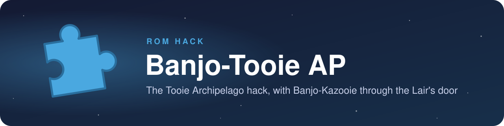

  

  
  
  

**A fork of [Auztin's Banjo-Tooie AP hack](https://github.com/Auztin/AP-Banjo-Tooie) (version 4.13.1) with the
Banjo-Tooie side of the [Banjo-Kazooie & Tooie dual-boot image](https://github.com/kegan-dev/AP-Banjo-Kazooie-Tooie)
added.** In the image, the entrance to Gruntilda's Lair in Spiral Mountain starts Banjo-Kazooie, and Banjo-Kazooie
comes back here. The [Banjo-Kazooie & Tooie world](https://github.com/kegan-dev/Archipelago-BanjoKazooieTooie) plays
it.

> [!NOTE]
> **Playing plain Banjo-Tooie AP?** Use [the original](https://github.com/jjjj12212/Archipelago-BanjoTooie). This
> fork is for the combined image. The upstream README is [here](../README.md).

## Branches

| Branch | What |
|---|---|
| `bkbt` (default) | The fork: hack 4.13.1 plus the dual-boot side |
| `dev`, `release`, `ap-release`, ... | The upstream branches, unchanged |

## What the fork adds

Without Banjo-Kazooie in the image the hack starts nothing and plays as hack 4.13.1. With it:

- **The launcher** (`n64/src/dualboot.c`, `n64/asm/dualboot.asm`): starts Banjo-Kazooie from its cart address and
  takes it back, through a handoff block both games read. The block's layout is `n64/src/dualboot.h`.
- **The hub door** (`n64/src/door.c`): with the combined client's `hub_door` setting, Tooie's Lair entrance saves and
  starts Banjo-Kazooie, and an arrival back loads the right file straight into Spiral Mountain, past the title.
- **Doors between the games** (`n64/src/exits.c`): a game per exit-map entry, so a Tooie world entrance can lead into
  Banjo-Kazooie.
- **Cheato** (`n64/src/cheato.c`): in King Jingaling's throne room, since the ruined Lair is where the door is.
- **The curtain**: a black, silent screen from the door to the destination.
- **The save**: Tooie's SRAM stops at `0x7000`, Banjo-Kazooie's starts there; each Tooie file links to its own
  Banjo-Kazooie save.
- **A GCC 16 build** for Windows: o32 throughout, compiler-rt's soft-float in `n64/src/compat/`, and trampolines that
  keep the callee's argument area free.

The contract between the two games is the image's
[docs/CONTRACT.md](https://github.com/kegan-dev/AP-Banjo-Kazooie-Tooie/blob/main/docs/CONTRACT.md).

## Building

The image repository builds this as one of its parts: [AP-Banjo-Kazooie-Tooie](https://github.com/kegan-dev/AP-Banjo-Kazooie-Tooie),
`hack/build_bt.sh`, with the setup in its [docs/BUILDING.md](https://github.com/kegan-dev/AP-Banjo-Kazooie-Tooie/blob/main/docs/BUILDING.md).

## Credits

Auztin wrote the Banjo-Tooie AP hack, with its other contributors; jjjj12212 and g0goTBC the
[Banjo-Tooie AP world](https://github.com/jjjj12212/Archipelago-BanjoTooie) it serves. This fork only adds the door
to Banjo-Kazooie.

## Licence

[MIT](../LICENSE), as upstream. `n64/src/compat/softfloat/` is from LLVM's compiler-rt and keeps its own licence
(Apache 2.0 with LLVM exceptions, in each file).
Banjo-Tooie is a trademark of its owners; this project isn't affiliated with them.
